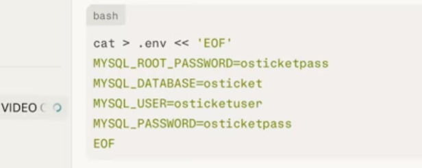
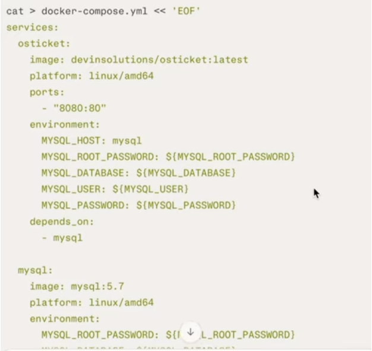
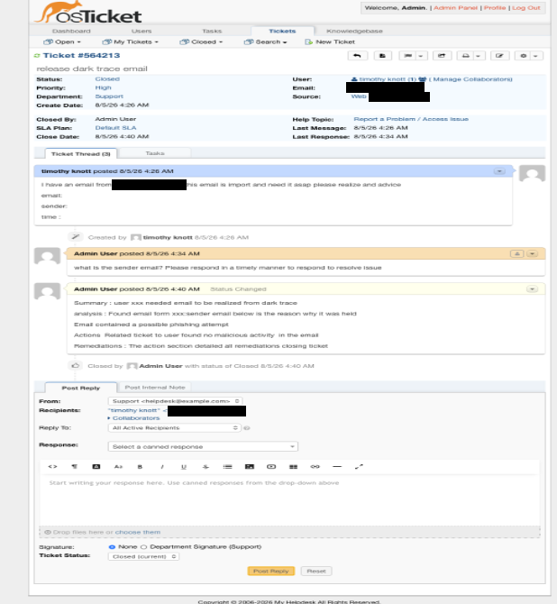
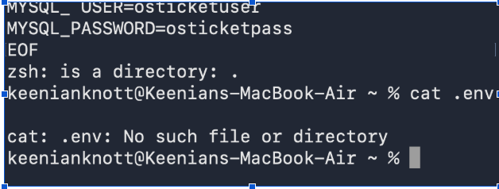

# osticket-helpdesk-lab
IT Help Desk ticketing system lab using osTicket and Docker
# osTicket Help Desk Lab

## Overview
This project demonstrates the setup and use of an IT help desk ticketing system using osTicket. The lab simulates a real-world help desk environment where users submit tickets, technicians manage requests, and issues are tracked through resolution.

## Skills Demonstrated
- Ticket creation and management
- Help desk workflow
- User and agent management
- Ticket assignment and prioritization
- Troubleshooting documentation
- Docker deployment
- Linux administration basics
- MySQL database configuration

## Tools Used
- osTicket
- Docker
- Docker Compose
- MySQL

## Setup Screenshots

> Lab-only default credentials; never use in production.

## Lab Tasks Completed
- Installed osTicket using Docker
- Configured the ticketing system
- Created and managed support tickets
- Assigned tickets to technicians
- Updated ticket status
- Resolved and closed tickets

## Example Ticket

## Troubleshooting

## What I Learned
This lab helped me understand how IT help desk teams use ticketing systems to track incidents, communicate with users, prioritize issues, and document solutions.
